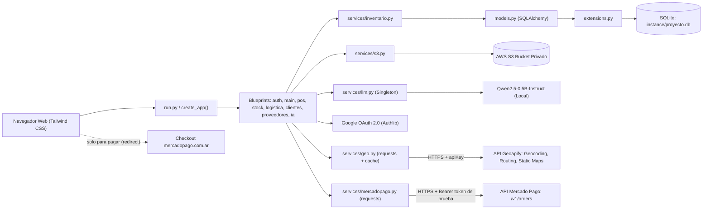
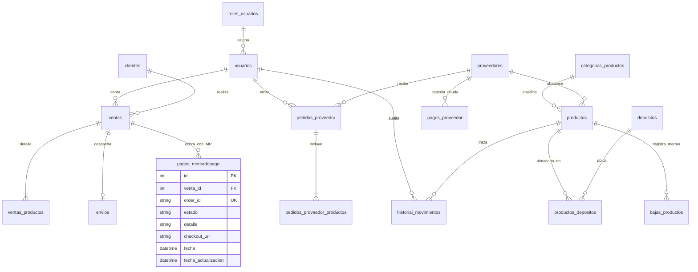
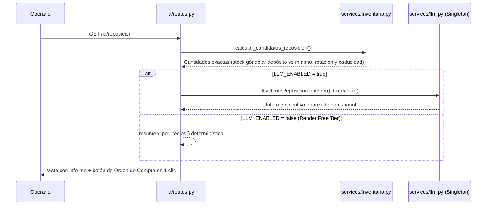
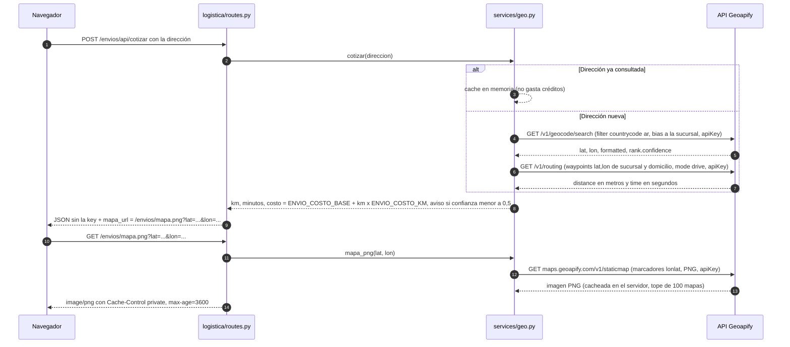
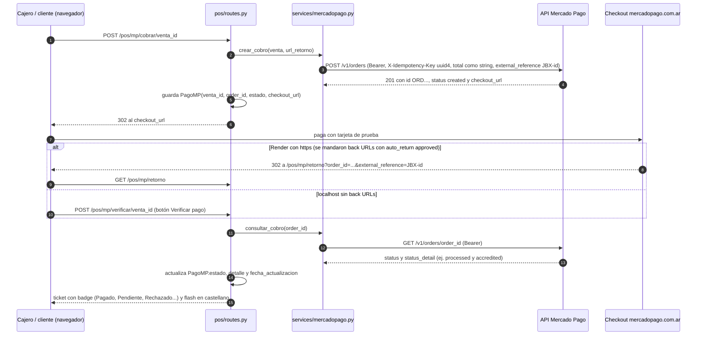
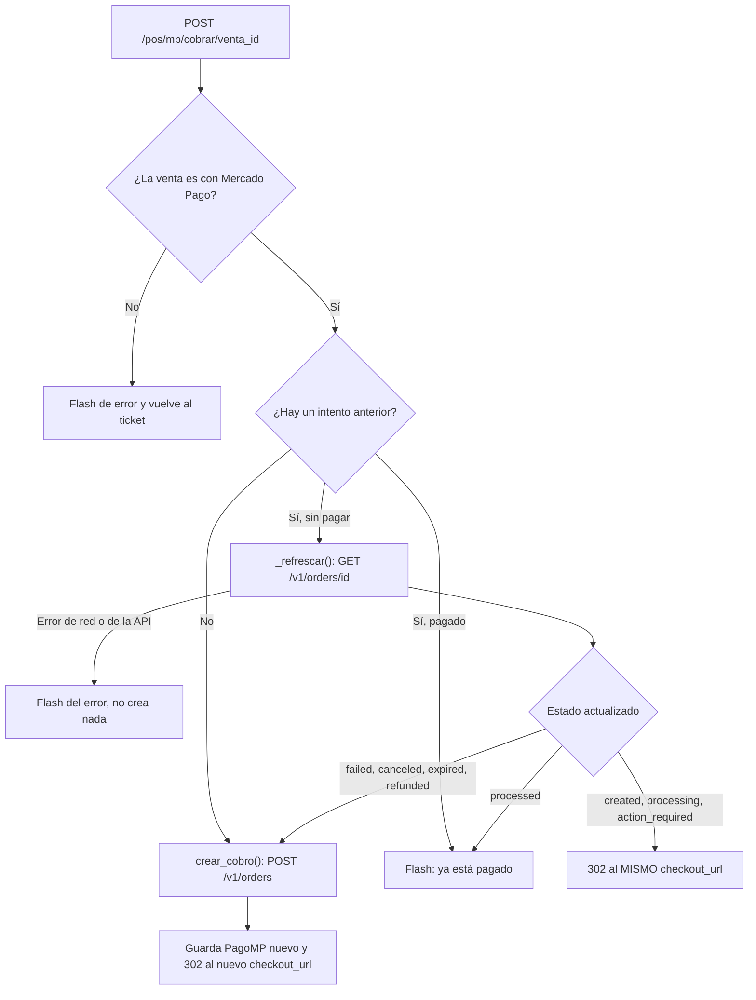

# Informe Técnico — Segundo Parcial: Implementación e Integración Tecnológica (JUMBOX)

> **Asignatura:** Análisis y Metodología de Sistemas — Escuela DaVinci  
> **Docente:** Prof. Gamaliel Quiroz  
> **Proyecto:** JUMBOX SaaS — Sistema de Gestión para Supermercados Minoristas  

---

## 1. Modelo Ambiental

El sistema **JUMBOX** fue migrado desde una aplicación de escritorio monolítica desarrollada en **Java Swing + MySQL (`supermercado.sql`)** y un primer prototipo web en un único archivo `app.py`, hacia una arquitectura web modular en **Python + Flask**, diseñada para operar tanto localmente como en la nube (**Render**).

### 1.1 Entorno de Hardware y Software
- **Sistema Operativo de Desarrollo:** Windows 11 (compatible con Linux en producción sobre contenedores Render).
- **Lenguaje y Runtime:** Python 3.12 / 3.14 con aislamiento de dependencias mediante entorno virtual (`venv`).
- **Framework Web:** Flask 3.0.3 bajo el patrón *Application Factory* (`create_app`) y servidor WSGI `Gunicorn` en producción.
- **Motor de Base de Datos:** SQLite 3 (`instance/proyecto.db`) gestionado mediante el ORM **SQLAlchemy 2 / Flask-SQLAlchemy**, con integridad referencial activa (`PRAGMA foreign_keys=ON`).
- **Servicios Externos Integrados:**
  1. **Autenticación Federada:** Google OAuth 2.0 / OpenID Connect (`Authlib`) + sesiones `Flask-Login` y hashing `Flask-Bcrypt` compatible con hashes `$2a$` heredados de `jBCrypt`.
  2. **Almacenamiento en la Nube:** **Amazon Web Services (AWS S3)** mediante `boto3`, utilizando un bucket privado y generación de URLs prefirmadas temporales (`s3v4`) para fotografías de productos y comprobantes de pago a proveedores.
  3. **Inteligencia Artificial Local:** Modelo de lenguaje instructivo **`Qwen/Qwen2.5-0.5B-Instruct`** ejecutado localmente con Hugging Face `transformers` y `PyTorch CPU`, inicializado bajo patrón **Singleton + Lazy Loading** para asistir en las decisiones de reposición de stock.
  4. **API externa de mapas — Geoapify:** consumida con `requests` desde `app/services/geo.py` para el módulo de Envíos. Usa tres endpoints REST con API key (`GEOAPIFY_API_KEY`): *Geocoding* (dirección → lat/lon), *Routing* (distancia y tiempo en auto desde la sucursal) y *Static Maps* (PNG con dos marcadores, servido a través de un proxy de Flask para que la key nunca llegue al navegador). Con la distancia se calcula un costo estimado de envío (`ENVIO_COSTO_BASE + km × ENVIO_COSTO_KM`).
  5. **API externa de pagos — Mercado Pago (Checkout Pro vía Orders API):** consumida con `requests` desde `app/services/mercadopago.py` para cobrar el ticket de las ventas con medio de pago "Mercado Pago". Crea la *order* (`POST /v1/orders`), redirige al checkout de `mercadopago.com.ar` y confirma el estado consultando la API (`GET /v1/orders/{id}`). Usa un Access Token **de prueba** (`MP_ACCESS_TOKEN`, `Authorization: Bearer`), por lo que no se mueve dinero real. Los cobros se guardan en la tabla nueva `pagos_mercadopago`.

  La guía para obtener las credenciales y probar ambas integraciones está en [`docs/GUIA_APIS_EXTERNAS.md`](GUIA_APIS_EXTERNAS.md).

---

## 2. Estructura del Proyecto y Modularización

Para cumplir las buenas prácticas de escalabilidad y mantenimiento, se eliminó el acoplamiento de rutas en un solo archivo y se organizó el proyecto bajo paquetes por dominio de negocio (**Blueprints**) con un flujo de importaciones estrictamente unidireccional:

$$\text{routes (Blueprints)} \longrightarrow \text{services (S3 / LLM / Inventario / Geo / Mercado Pago)} \longrightarrow \text{models (SQLAlchemy)} \longrightarrow \text{extensions}$$

```text
supermercado/
├── run.py                      # Único punto de entrada (python run.py / gunicorn run:app)
├── config.py                   # Configuración por entorno (.env) y TestingConfig
├── requirements.txt            # Dependencias de producción (Flask, boto3, requests, transformers, torch CPU)
├── .env.example                # Plantilla pública de variables de entorno
├── migracion/
│   ├── supermercado.sql        # Volcado MySQL original del proyecto Java
│   ├── convertir_dump.py       # Parser que convierte el SQL a seed.json y extrae BLOBs
│   ├── seed.json               # Datos limpios listos para sembrar en SQLite
│   └── fotos/                  # Imágenes WebP/JPG extraídas de los LONGBLOB de MySQL
├── tests/
│   ├── test_jumbox.py          # Suite automatizada con Pytest (migración, auth, POS, S3 y LLM)
│   ├── test_geoapify.py        # Geoapify: geocoding, ruta, costo, cache, proxy del mapa y errores (red mockeada)
│   └── test_mercadopago.py     # Mercado Pago: crear/consultar order, retorno, verificar, doble cobro y errores (red mockeada)
└── app/
    ├── __init__.py             # Application Factory create_app() y registro de Blueprints
    ├── extensions.py           # Instancias desacopladas: db, login_manager, bcrypt, oauth
    ├── models.py               # 17 modelos SQLAlchemy (tablas migradas + envios, pagos y pagos_mercadopago)
    ├── decorators.py           # Control de acceso por rol: @rol_requerido(...)
    ├── seed.py                 # Sembrado automático idempotente y subida inicial a S3
    ├── services/
    │   ├── s3.py               # Cliente Boto3 singleton, subida y URLs prefirmadas
    │   ├── llm.py              # Inferencia con Qwen2.5-0.5B-Instruct (Singleton + Fallback)
    │   ├── inventario.py       # Transacciones atómicas de ventas, mermas, traslados y pedidos
    │   ├── geo.py              # API externa Geoapify: geocoding, routing, mapa estático y costo de envío
    │   └── mercadopago.py      # API externa Mercado Pago: crear y consultar el cobro (Checkout Pro vía Orders)
    ├── auth/routes.py          # Login local, Google OAuth y elección de rol (Operario/Cajero)
    ├── main/routes.py          # Dashboard Bento con KPIs reales y buscador global (Cmd+K)
    ├── pos/routes.py           # Punto de Venta split-screen 60/40, tickets y cobro con Mercado Pago
    ├── stock/routes.py         # Inventario con semáforo FEFO, mermas y auditoría de movimientos
    ├── logistica/routes.py     # Tablero de envíos (En preparación -> En camino -> Entregado) + ruta, costo y mapa (proxy) con Geoapify
    ├── clientes/routes.py      # ABM de clientes y programa de fidelización (1 punto cada $100)
    ├── proveedores/routes.py   # Órdenes de compra a depósito, cuenta corriente y pagos con S3
    └── ia/routes.py            # Módulo de sugerencias de reposición asistido por IA
```

### ¿Cómo facilita esta estructura la migración y expansión?
- **Desacoplamiento de infraestructura:** Si se desea migrar de SQLite a PostgreSQL en producción, solo se modifica `DATABASE_URL` en `.env` sin alterar ningún Blueprint ni modelo.
- **Encapsulamiento de servicios:** Toda la comunicación con AWS S3 vive en `app/services/s3.py`, toda la inferencia neuronal en `app/services/llm.py`, y cada API externa en su propio módulo (`app/services/geo.py` para Geoapify y `app/services/mercadopago.py` para Mercado Pago). Las rutas web nunca instancian clientes de AWS ni pipelines de Hugging Face, ni arman requests HTTP a las APIs externas: llaman a funciones del servicio (`geo.cotizar()`, `mp.crear_cobro()`, `mp.consultar_cobro()`). Por ejemplo, pasar de la Orders API a Preferences de Mercado Pago solo cambiaría `mercadopago.py`.

---

## 3. Librerías y Dependencias Utilizadas

| Librería | Versión | Propósito en el Proyecto |
|---|---|---|
| `Flask` | `3.0.3` | Microframework web, ruteo por Blueprints, sesiones firmadas y motor Jinja2. |
| `Flask-SQLAlchemy` | `3.1.1` | ORM relacional para mapear las tablas migradas de MySQL sobre SQLite. |
| `Flask-Login` | `0.6.3` | Gestión de sesión de usuario (`current_user`, `@login_required`). |
| `Flask-Bcrypt` | `1.0.1` | Hashing y verificación de contraseñas (compatible con `$2a$` de Java `jBCrypt`). |
| `Authlib` | `1.3.2` | Cliente OpenID Connect para el flujo de autenticación con **Google OAuth 2.0**. |
| `boto3` | `1.35.36` | SDK oficial de AWS para subir archivos y firmar URLs temporales en **Amazon S3**. |
| `requests` | `2.32.3` | Cliente HTTP para consumir las APIs REST externas: **Geoapify** (geocoding, routing y mapa estático, con `timeout=8`) y **Mercado Pago** (`POST`/`GET /v1/orders`, con `timeout=15`). No se usan SDKs propietarios: las dos integraciones son HTTP puro. |
| `transformers` | `>=4.45` | Pipeline `text-generation` de Hugging Face para ejecutar la LLM local. |
| `torch` (CPU) | `>=2.5` | Tensor backend en versión CPU liviana para correr `Qwen/Qwen2.5-0.5B-Instruct`. |
| `python-dotenv` | `1.0.1` | Carga de secretos y credenciales desde el archivo `.env`. |
| `gunicorn` | `22.0.0` | Servidor WSGI de producción utilizado en el despliegue sobre Render. |
| `pytest` | `>=8.0` | Ejecución de pruebas unitarias y de integración sobre base en memoria. |

---

## 4. Instrucciones de Ejecución Local

1. **Clonar el repositorio y abrir la carpeta de la aplicación:**
   ```powershell
   cd Jumbox-Analisis-Metodologias-Sistemas/supermercado
   ```
2. **Crear y activar el entorno virtual:**
   ```powershell
   python -m venv .venv
   .\.venv\Scripts\Activate.ps1
   ```
3. **Instalar las dependencias:**
   ```powershell
   pip install -r requirements.txt -r requirements-dev.txt
   ```
4. **Configurar las variables de entorno:**
   Copiar `.env.example` a `.env`. Si no se configuran credenciales de AWS S3, el servicio activa automáticamente un *fallback* en `app/static/uploads/` para permitir evaluar el sistema sin conexión a AWS. Si `LLM_ENABLED=true`, la primera consulta a `/ia/reposicion` descargará el modelo `Qwen/Qwen2.5-0.5B-Instruct`. Sin `GEOAPIFY_API_KEY` o sin `MP_ACCESS_TOKEN`, Envíos y el ticket muestran un aviso de configuración y el resto del sistema funciona igual (ver [`GUIA_APIS_EXTERNAS.md`](GUIA_APIS_EXTERNAS.md)).
5. **Ejecutar el servidor:**
   ```powershell
   python run.py
   ```
   Acceder desde el navegador a `http://127.0.0.1:5000` e ingresar con `administrador` / `1234`, `operario` / `1234` o `cajero` / `1234`.

---

## 5. Diagramas de Arquitectura, Datos y Flujos

### 5.1 Arquitectura en Capas e Integraciones Externas



Las keys de Geoapify y Mercado Pago solo existen del lado del servidor (`config.py` las lee del `.env`). El navegador habla siempre con Flask; la única excepción es el checkout de Mercado Pago, al que el cliente llega por un *redirect* con un link de pago que no contiene el token.

### 5.2 Diagrama Entidad-Relación (Migrado de `supermercado.sql` + Extensiones)



`pagos_mercadopago` es una tabla **nueva** (no existía en `supermercado.sql`), por eso `db.create_all()` la crea sin migrar la base existente. Una venta puede tener varios intentos de cobro (por ejemplo, uno rechazado y otro aprobado), pero nunca dos abiertos a la vez. `estado` guarda el `status` de la order (`created`, `processing`, `processed`, `failed`, `canceled`, `expired`, `refunded`…) y `detalle` el `status_detail` crudo (por ejemplo `accredited` o `rejected_by_issuer`), que la pantalla traduce al castellano.

### 5.3 Flujo Híbrido de Reposición con IA Local



### 5.4 Flujo de Envíos con Geoapify (ruta, costo y mapa)

Pantalla `/envios` (`templates/logistica/envio.html`). El cuadro **"Probar dirección"** hace `POST /envios/api/cotizar` con la dirección escrita, y el botón **"Ver ruta"** de cada tarjeta hace `GET /envios/<id>/ruta` con la dirección guardada en el envío (los primeros 6 se cargan solos, de a uno, para respetar el límite de 5 consultas por segundo). Las dos rutas llaman a `geo.cotizar()`.



Decisiones de diseño:
- **La key nunca llega al navegador:** el `` apunta al proxy `logistica.mapa`, que solo acepta coordenadas dentro de Argentina (así nadie lo usa para pedir mapas de otros lugares con nuestros créditos).
- **Errores sin fugas:** `_consultar()` traduce *timeout* (8 s), falta de conexión, 401/403, 429 y 5xx a un `ErrorGeo` con mensaje propio en castellano. Nunca se muestra `str(exc)` de `requests` porque incluye la URL con la key. `cotizar()` nunca lanza excepciones: devuelve `ok: false` y un `error`, y la página sigue funcionando. Si falla solo el mapa, el proxy responde un SVG "Mapa no disponible" (502).
- **Orden de coordenadas:** Routing usa `lat,lon`; Static Maps y el *bias* del Geocoding usan `lon,lat`.
- **Sin key** (`GEOAPIFY_API_KEY` vacía, como en `TestingConfig`), la pantalla muestra cómo configurarla y no hace ningún request.

### 5.5 Flujo de Cobro con Mercado Pago (Checkout Pro vía Orders API)

Disponible en el ticket (`templates/pos/ticket.html`) de las ventas registradas con medio de pago "Mercado Pago". Las tres rutas exigen rol Admin o Cajero.



Para no cobrar dos veces el mismo ticket, `mp_cobrar` decide así antes de crear una order nueva:



Decisiones de diseño:
- **La fuente de verdad es la API:** el `?status=approved` del regreso se ignora (se puede editar a mano); siempre se re-consulta `GET /v1/orders/{id}`. El regreso busca el cobro por `order_id` o, como plan B, por `external_reference` validada con `re.fullmatch(r"JBX-(\d{1,9})", ..., flags=re.ASCII)`.
- **Back URLs solo en https:** `url_for("pos.mp_retorno", _external=True)` sale `https://` en Render gracias a `ProxyFix`; en localhost no se envía `config.online` (Mercado Pago no acepta `localhost`) y se usa "Verificar pago".
- **Montos:** un solo ítem por el total del ticket, como string con 2 decimales, para que `total_amount` coincida siempre con la suma de los ítems. No se envía `allowed_user_type`, para permitir pagar como invitado.
- **Errores:** `_error_http()` traduce 400, 401/403, 404, 409, 429 y 5xx a mensajes para el cajero; los errores de red (*timeout* de 15 s) tampoco muestran la URL ni el token.
- **Ticket siempre fresco:** la vista responde `Cache-Control: no-store` y recarga con `pageshow` si el navegador la restaura al tocar "Atrás" desde el checkout.
- **Cobro posterior a la venta:** la venta y el descuento de stock se registran antes de cobrar; si Mercado Pago rechaza, se reintenta o se cobra con otro medio.

---

## 6. Proceso de Migración (`supermercado.sql` → SQLite + S3) y Desafíos Técnicos

### 6.1 Decisiones Técnicas y Desafíos Resueltos
1. **Extracción de imágenes `LONGBLOB` hacia AWS S3:**
   El volcado MySQL original almacenaba las fotos de los productos (`CocaCola`, `Lays`, `Cheetos`, `Topline`) como bloques binarios hexadecimales (`0x52494646...`) dentro de la tabla `productos`, inflando el archivo SQL y degradando las consultas. Se construyó `migracion/convertir_dump.py`, que inspecciona los *magic bytes* de cada BLOB (`RIFF..WEBP` y `FFD8..JPG`), extrae los archivos a `migracion/fotos/` y reemplaza la columna binaria por `foto_key` (`VARCHAR`). Al sembrar la base, `app/seed.py` sube las imágenes a S3 con keys deterministas (`productos/seed/<id>.webp`) y las plantillas las renderizan mediante URLs prefirmadas temporales de 1 hora.
2. **Compatibilidad criptográfica de contraseñas (`jBCrypt` → `Flask-Bcrypt`):**
   Las cuentas del sistema Java tenían hashes `$2a$10$...` generados por `jBCrypt`, mientras que el usuario `administrador` tenía la clave `1234` en texto plano. En `app/seed.py` se implementó una detección de prefijo: los hashes `$2a$` se conservaron intactos (verificando que `Flask-Bcrypt` valida la clave `1234` sin obligar a los usuarios a cambiarla) y las claves en texto plano se hashearon automáticamente.
3. **Saneamiento de integridad referencial huérfana:**
   En MySQL la tabla `ventas` carecía de `FOREIGN KEY` activa y la venta `#1` apuntaba a `fk_usuario = 3`, inexistente en `usuarios`. Al activar `PRAGMA foreign_keys=ON` en SQLite, el sembrado detecta referencias huérfanas y las reasigna al administrador (`id = 1`), preservando el historial estadístico sin violar la integridad referencial.
4. **Diseño Híbrido para la LLM Local y Límite de Memoria en Render:**
   Los modelos pequeños (`0.5B` parámetros) son propensos a alucinar operaciones aritméticas si se les pide calcular stocks directamente. Además, el plan gratuito de Render dispone de 512 MB de RAM, insuficiente para cargar PyTorch + pesos del modelo (~1,2 GB). Se resolvió separando responsabilidades: `inventario.calcular_candidatos_reposicion()` calcula en Python las cantidades exactas según rotación, stock en góndola/depósito y fecha de vencimiento, y `services/llm.py` utiliza el modelo `Qwen/Qwen2.5-0.5B-Instruct` (cargado una única vez con patrón *Singleton* e import diferido) exclusivamente para redactar y priorizar el informe ejecutivo, contando con un *fallback* automático por reglas cuando `LLM_ENABLED=false`.

### 6.2 Resultados Obtenidos y Mejoras Futuras
- **Resultados:** Se obtuvo una plataforma web completa que cubre el ciclo operativo del supermercado (compra a proveedor → ingreso a depósito → traslado a góndola → venta POS con fidelización, cobro con Mercado Pago y despacho a domicilio con ruta y costo de Geoapify → control de vencimientos y mermas), respaldada por 77 pruebas automatizadas: `tests/test_jumbox.py` (7), `tests/test_geoapify.py` (41) y `tests/test_mercadopago.py` (29). Las pruebas de las APIs externas mockean `requests`, de modo que corren sin keys y sin internet.
- **Proyección futura:**
  1. Migrar la persistencia en Render a **PostgreSQL administrado** para evitar el almacenamiento efímero entre despliegues.
  2. Incorporar trazabilidad por **Lotes múltiples (`Lote`)** por producto para aplicar despacho FEFO (*First Expired, First Out*) cuando coexisten distintas partidas del mismo SKU.
  3. Integrar notificaciones automáticas por WhatsApp/email al cambiar el estado del envío en el módulo de logística.
  4. Recibir el **webhook** de Mercado Pago (evento *Order*, con validación de la firma `x-signature`) para confirmar los pagos sin depender del regreso del navegador ni del botón "Verificar pago".
