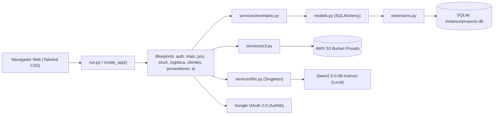
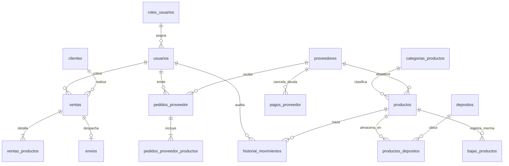
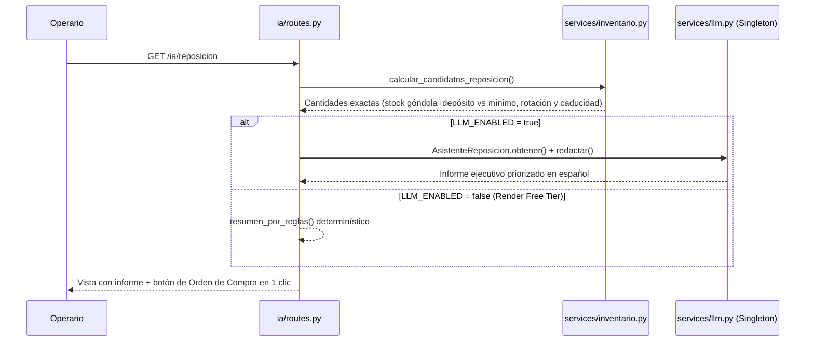

# Informe Técnico — Segundo Parcial: Implementación e Integración Tecnológica (JUMBOX)

> **Asignatura:** Análisis y Metodología de Sistemas — Escuela DaVinci  
> **Docente:** Prof. Gamaliel Quiroz  
> **Proyecto:** JUMBOX SaaS — Sistema de Gestión para Supermercados Minoristas  

---

## 1. Modelo Ambiental

El sistema **JUMBOX** fue migrado desde una aplicación de escritorio monolítica desarrollada en **Java Swing + MySQL (`supermercado.sql`)** y un primer prototipo web en un único archivo `app.py`, hacia una arquitectura web modular en **Python + Flask**, diseñada para operar tanto localmente como en la nube (**Render**).

### 1.1 Entorno de Hardware y Software
- **Sistema Operativo de Desarrollo:** Windows 11 (compatible con Linux en producción sobre contenedores Render).
- **Lenguaje y Runtime:** Python 3.12 / 3.14 con aislamiento de dependencias mediante entorno virtual (`venv`).
- **Framework Web:** Flask 3.0.3 bajo el patrón *Application Factory* (`create_app`) y servidor WSGI `Gunicorn` en producción.
- **Motor de Base de Datos:** SQLite 3 (`instance/proyecto.db`) gestionado mediante el ORM **SQLAlchemy 2 / Flask-SQLAlchemy**, con integridad referencial activa (`PRAGMA foreign_keys=ON`).
- **Servicios Externos Integrados:**
  1. **Autenticación Federada:** Google OAuth 2.0 / OpenID Connect (`Authlib`) + sesiones `Flask-Login` y hashing `Flask-Bcrypt` compatible con hashes `$2a$` heredados de `jBCrypt`.
  2. **Almacenamiento en la Nube:** **Amazon Web Services (AWS S3)** mediante `boto3`, utilizando un bucket privado y generación de URLs prefirmadas temporales (`s3v4`) para fotografías de productos y comprobantes de pago a proveedores.
  3. **Inteligencia Artificial Local:** Modelo de lenguaje instructivo **`Qwen/Qwen2.5-0.5B-Instruct`** ejecutado localmente con Hugging Face `transformers` y `PyTorch CPU`, inicializado bajo patrón **Singleton + Lazy Loading** para asistir en las decisiones de reposición de stock.

---

## 2. Estructura del Proyecto y Modularización

Para cumplir las buenas prácticas de escalabilidad y mantenimiento, se eliminó el acoplamiento de rutas en un solo archivo y se organizó el proyecto bajo paquetes por dominio de negocio (**Blueprints**) con un flujo de importaciones estrictamente unidireccional:

$$\text{routes (Blueprints)} \longrightarrow \text{services (S3 / LLM / Inventario)} \longrightarrow \text{models (SQLAlchemy)} \longrightarrow \text{extensions}$$

```text
supermercado/
├── run.py                      # Único punto de entrada (python run.py / gunicorn run:app)
├── config.py                   # Configuración por entorno (.env) y TestingConfig
├── requirements.txt            # Dependencias de producción (Flask, boto3, transformers, torch CPU)
├── .env.example                # Plantilla pública de variables de entorno
├── migracion/
│   ├── supermercado.sql        # Volcado MySQL original del proyecto Java
│   ├── convertir_dump.py       # Parser que convierte el SQL a seed.json y extrae BLOBs
│   ├── seed.json               # Datos limpios listos para sembrar en SQLite
│   └── fotos/                  # Imágenes WebP/JPG extraídas de los LONGBLOB de MySQL
├── tests/
│   └── test_jumbox.py          # Suite automatizada con Pytest (migración, auth, POS, S3 y LLM)
└── app/
    ├── __init__.py             # Application Factory create_app() y registro de Blueprints
    ├── extensions.py           # Instancias desacopladas: db, login_manager, bcrypt, oauth
    ├── models.py               # 14 modelos SQLAlchemy (tablas originales + envios y pagos)
    ├── decorators.py           # Control de acceso por rol: @rol_requerido(...)
    ├── seed.py                 # Sembrado automático idempotente y subida inicial a S3
    ├── services/
    │   ├── s3.py               # Cliente Boto3 singleton, subida y URLs prefirmadas
    │   ├── llm.py              # Inferencia con Qwen2.5-0.5B-Instruct (Singleton + Fallback)
    │   └── inventario.py       # Transacciones atómicas de ventas, mermas, traslados y pedidos
    ├── auth/routes.py          # Login local, Google OAuth y elección de rol (Operario/Cajero)
    ├── main/routes.py          # Dashboard Bento con KPIs reales y buscador global (Cmd+K)
    ├── pos/routes.py           # Punto de Venta split-screen 60/40 y emisión de tickets
    ├── stock/routes.py         # Inventario con semáforo FEFO, mermas y auditoría de movimientos
    ├── logistica/routes.py     # Tablero de envíos a domicilio (En preparación -> En camino -> Entregado)
    ├── clientes/routes.py      # ABM de clientes y programa de fidelización (1 punto cada $100)
    ├── proveedores/routes.py   # Órdenes de compra a depósito, cuenta corriente y pagos con S3
    └── ia/routes.py            # Módulo de sugerencias de reposición asistido por IA
```

### ¿Cómo facilita esta estructura la migración y expansión?
- **Desacoplamiento de infraestructura:** Si se desea migrar de SQLite a PostgreSQL en producción, solo se modifica `DATABASE_URL` en `.env` sin alterar ningún Blueprint ni modelo.
- **Encapsulamiento de servicios:** Toda la comunicación con AWS S3 vive en `app/services/s3.py` y toda la inferencia neuronal en `app/services/llm.py`. Las rutas web nunca instancian clientes de AWS ni pipelines de Hugging Face directamente.

---

## 3. Librerías y Dependencias Utilizadas

| Librería | Versión | Propósito en el Proyecto |
|---|---|---|
| `Flask` | `3.0.3` | Microframework web, ruteo por Blueprints, sesiones firmadas y motor Jinja2. |
| `Flask-SQLAlchemy` | `3.1.1` | ORM relacional para mapear las tablas migradas de MySQL sobre SQLite. |
| `Flask-Login` | `0.6.3` | Gestión de sesión de usuario (`current_user`, `@login_required`). |
| `Flask-Bcrypt` | `1.0.1` | Hashing y verificación de contraseñas (compatible con `$2a$` de Java `jBCrypt`). |
| `Authlib` | `1.3.2` | Cliente OpenID Connect para el flujo de autenticación con **Google OAuth 2.0**. |
| `boto3` | `1.35.36` | SDK oficial de AWS para subir archivos y firmar URLs temporales en **Amazon S3**. |
| `transformers` | `>=4.45` | Pipeline `text-generation` de Hugging Face para ejecutar la LLM local. |
| `torch` (CPU) | `>=2.5` | Tensor backend en versión CPU liviana para correr `Qwen/Qwen2.5-0.5B-Instruct`. |
| `python-dotenv` | `1.0.1` | Carga de secretos y credenciales desde el archivo `.env`. |
| `gunicorn` | `22.0.0` | Servidor WSGI de producción utilizado en el despliegue sobre Render. |
| `pytest` | `>=8.0` | Ejecución de pruebas unitarias y de integración sobre base en memoria. |

---

## 4. Instrucciones de Ejecución Local

1. **Clonar el repositorio y abrir la carpeta de la aplicación:**
   ```powershell
   cd Jumbox-Analisis-Metodologias-Sistemas/supermercado
   ```
2. **Crear y activar el entorno virtual:**
   ```powershell
   python -m venv .venv
   .\.venv\Scripts\Activate.ps1
   ```
3. **Instalar las dependencias:**
   ```powershell
   pip install -r requirements.txt -r requirements-dev.txt
   ```
4. **Configurar las variables de entorno:**
   Copiar `.env.example` a `.env`. Si no se configuran credenciales de AWS S3, el servicio activa automáticamente un *fallback* en `app/static/uploads/` para permitir evaluar el sistema sin conexión a AWS. Si `LLM_ENABLED=true`, la primera consulta a `/ia/reposicion` descargará el modelo `Qwen/Qwen2.5-0.5B-Instruct`.
5. **Ejecutar el servidor:**
   ```powershell
   python run.py
   ```
   Acceder desde el navegador a `http://127.0.0.1:5000` e ingresar con `administrador` / `1234`, `operario` / `1234` o `cajero` / `1234`.

---

## 5. Diagramas de Arquitectura, Datos y Flujos

### 5.1 Arquitectura en Capas e Integraciones Externas



### 5.2 Diagrama Entidad-Relación (Migrado de `supermercado.sql` + Extensiones)



### 5.3 Flujo Híbrido de Reposición con IA Local



---

## 6. Proceso de Migración (`supermercado.sql` → SQLite + S3) y Desafíos Técnicos

### 6.1 Decisiones Técnicas y Desafíos Resueltos
1. **Extracción de imágenes `LONGBLOB` hacia AWS S3:**
   El volcado MySQL original almacenaba las fotos de los productos (`CocaCola`, `Lays`, `Cheetos`, `Topline`) como bloques binarios hexadecimales (`0x52494646...`) dentro de la tabla `productos`, inflando el archivo SQL y degradando las consultas. Se construyó `migracion/convertir_dump.py`, que inspecciona los *magic bytes* de cada BLOB (`RIFF..WEBP` y `FFD8..JPG`), extrae los archivos a `migracion/fotos/` y reemplaza la columna binaria por `foto_key` (`VARCHAR`). Al sembrar la base, `app/seed.py` sube las imágenes a S3 con keys deterministas (`productos/seed/<id>.webp`) y las plantillas las renderizan mediante URLs prefirmadas temporales de 1 hora.
2. **Compatibilidad criptográfica de contraseñas (`jBCrypt` → `Flask-Bcrypt`):**
   Las cuentas del sistema Java tenían hashes `$2a$10$...` generados por `jBCrypt`, mientras que el usuario `administrador` tenía la clave `1234` en texto plano. En `app/seed.py` se implementó una detección de prefijo: los hashes `$2a$` se conservaron intactos (verificando que `Flask-Bcrypt` valida la clave `1234` sin obligar a los usuarios a cambiarla) y las claves en texto plano se hashearon automáticamente.
3. **Saneamiento de integridad referencial huérfana:**
   En MySQL la tabla `ventas` carecía de `FOREIGN KEY` activa y la venta `#1` apuntaba a `fk_usuario = 3`, inexistente en `usuarios`. Al activar `PRAGMA foreign_keys=ON` en SQLite, el sembrado detecta referencias huérfanas y las reasigna al administrador (`id = 1`), preservando el historial estadístico sin violar la integridad referencial.
4. **Diseño Híbrido para la LLM Local y Límite de Memoria en Render:**
   Los modelos pequeños (`0.5B` parámetros) son propensos a alucinar operaciones aritméticas si se les pide calcular stocks directamente. Además, el plan gratuito de Render dispone de 512 MB de RAM, insuficiente para cargar PyTorch + pesos del modelo (~1,2 GB). Se resolvió separando responsabilidades: `inventario.calcular_candidatos_reposicion()` calcula en Python las cantidades exactas según rotación, stock en góndola/depósito y fecha de vencimiento, y `services/llm.py` utiliza el modelo `Qwen/Qwen2.5-0.5B-Instruct` (cargado una única vez con patrón *Singleton* e import diferido) exclusivamente para redactar y priorizar el informe ejecutivo, contando con un *fallback* automático por reglas cuando `LLM_ENABLED=false`.

### 6.2 Resultados Obtenidos y Mejoras Futuras
- **Resultados:** Se obtuvo una plataforma web completa que cubre el ciclo operativo del supermercado (compra a proveedor → ingreso a depósito → traslado a góndola → venta POS con fidelización y despacho a domicilio → control de vencimientos y mermas), respaldada por pruebas automatizadas en `tests/test_jumbox.py`.
- **Proyección futura:**
  1. Migrar la persistencia en Render a **PostgreSQL administrado** para evitar el almacenamiento efímero entre despliegues.
  2. Incorporar trazabilidad por **Lotes múltiples (`Lote`)** por producto para aplicar despacho FEFO (*First Expired, First Out*) cuando coexisten distintas partidas del mismo SKU.
  3. Integrar notificaciones automáticas por WhatsApp/email al cambiar el estado del envío en el módulo de logística.
