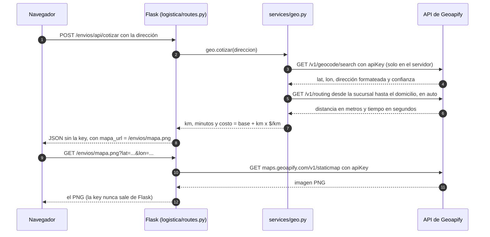
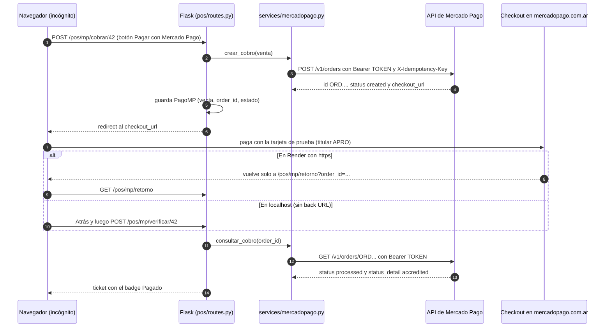

# Guía: APIs externas de Jumbox (Geoapify y Mercado Pago)

> **Para:** el profesor y los alumnos. Cómo sacar las keys, dónde cargarlas y cómo probar todo en 5 minutos.  
> **Estado:** el código y los tests ya están (`app/services/geo.py`, `app/services/mercadopago.py`). **Solo falta sacar las dos keys y cargarlas en `.env` y en Render.**  
> **Paneles y documentación consultados el 04/11/2026:** las pantallas y los límites **pueden cambiar**.

---

## 1. ¿Qué es una API key / Access Token?

Es una **contraseña que identifica a Jumbox ante un servicio externo**: con ella el servicio sabe quién pide, cuánta cuota le queda y qué puede hacer.
Es lo mismo que el `GOOGLE_CLIENT_SECRET` de Google OAuth de la Clase 14: vive en el `.env`, la usa **solo el servidor**, y si se filtra cualquiera puede hacerse pasar por nosotros.
Geoapify la recibe en la URL (`?apiKey=...`) y Mercado Pago en un header (`Authorization: Bearer APP_USR-...`).
Por eso el navegador **nunca** habla directo con esas APIs: le pide a Flask, y Flask llama a la API con la key.

---

## 2. Para qué usa Jumbox cada API

| API | Dónde se ve | Qué hace | Endpoints que usa | Variable |
|---|---|---|---|---|
| **Geoapify** | **Envíos / Delivery** (`/envios`) | Ubica la dirección del envío, calcula la distancia y el tiempo **en auto** desde la sucursal, estima el costo (`$1.500 fijo + $400 por km`, configurable) y dibuja un mapa con la sucursal (azul) y el domicilio (verde) | `GET /v1/geocode/search`, `GET /v1/routing`, `GET maps.geoapify.com/v1/staticmap` | `GEOAPIFY_API_KEY` |
| **Mercado Pago** (Checkout Pro vía Orders API) | **Caja / POS** → ticket de una venta con medio de pago "Mercado Pago" | Crea el cobro por el total del ticket, manda al cliente a pagar a `mercadopago.com.ar` y después **le pregunta a la API** si se pagó | `POST /v1/orders`, `GET /v1/orders/{id}` | `MP_ACCESS_TOKEN` |

Dónde está en el código:

| Archivo | Qué tiene |
|---|---|
| `app/services/geo.py` | `geocodificar()`, `ruta()`, `costo_envio()`, `cotizar()` y `mapa_png()`, con cache en memoria y mensajes de error propios (sin la key) |
| `app/logistica/routes.py` | `POST /envios/api/cotizar`, `GET /envios/<id>/ruta` y `GET /envios/mapa.png` (proxy del mapa) |
| `app/templates/logistica/envio.html` | Cuadro "Probar dirección" y botón "Ver ruta" en cada envío |
| `app/services/mercadopago.py` | `crear_cobro()`, `consultar_cobro()` y la traducción de estados y errores al castellano |
| `app/pos/routes.py` | `POST /pos/mp/cobrar/<id>`, `GET /pos/mp/retorno` y `POST /pos/mp/verificar/<id>` |
| `app/templates/pos/ticket.html` | Badge del estado, botones "Pagar con Mercado Pago" y "Verificar pago" |
| `app/models.py` | Modelo `PagoMP` (tabla nueva `pagos_mercadopago`) |
| `tests/test_geoapify.py`, `tests/test_mercadopago.py` | 70 tests con la red **siempre mockeada** |

---

## 3. Cómo sacar la key de Geoapify (gratis, sin tarjeta)

1. Entrá a <https://myprojects.geoapify.com> y registrate (email o Google). **No pide tarjeta.**
2. Verificá el email.
3. Tocá **Create project** y ponele un nombre, por ejemplo `Jumbox`.
4. La **API key se genera sola** al crear el proyecto. Copiala.
5. Pegala en `GEOAPIFY_API_KEY` (ver sección 5).

---

## 4. Cómo sacar el Access Token de Mercado Pago (de PRUEBA)

1. Entrá a <https://www.mercadopago.com.ar/developers> con tu cuenta **real** de Mercado Pago (tiene que ser de un mayor de edad).
2. **Tus integraciones** → **Crear aplicación** (<https://www.mercadopago.com.ar/developers/panel/app>). Nombre: `Jumbox POS`; desarrollo propio; pagos online; producto **Checkout Pro**.
3. Puede pedirte **verificación de identidad** o reautenticación. Hacelo **días antes** de la entrega, nunca en la defensa.
4. Dentro de la app, elegí **Prueba** → **Credenciales**.
5. Copiá el **Access Token**: empieza con **`APP_USR-`**. La *Public Key* no hace falta (Jumbox no la usa).
6. Pegalo en `MP_ACCESS_TOKEN` (ver sección 5).

> ⚠️ **NO actives el ambiente de producción** ni copies las credenciales de producción: harían **cobros con plata real**. Ojo: el token de producción **también** empieza con `APP_USR-`, así que lo único que garantiza que sea de prueba es copiarlo desde el selector **Prueba**.
>
> Si reusás una app vieja con un token `TEST-...`, la Orders API responde **401**. Creá una aplicación nueva.

---

## 5. Dónde se cargan las keys

**Solo en dos lugares: el `.env` local y Render → Environment.** Nunca en el código, en git, en un template, en el JavaScript, en un chat ni en una captura.

### 5.1 Local (`.env`)

1. Si no tenés `.env`, copiá la plantilla: `Copy-Item .env.example .env`.
2. Completá (los valores de abajo son **de ejemplo**, no son keys reales):

   ```dotenv
   GEOAPIFY_API_KEY="tu-key-de-geoapify"
   MP_ACCESS_TOKEN="APP_USR-xxxxxxxxxxxxxxxx"

   # Opcionales (si no están, se usan estos valores por defecto)
   SUCURSAL_NOMBRE="Sucursal Centro"
   SUCURSAL_LAT="-34.6037"
   SUCURSAL_LON="-58.3816"
   ENVIO_COSTO_BASE="1500"
   ENVIO_COSTO_KM="400"
   ```

3. **Reiniciá el servidor** (`Ctrl+C` y `python run.py`): `config.py` lee el `.env` solo al arrancar.

| Variable | Para qué | Por defecto |
|---|---|---|
| `GEOAPIFY_API_KEY` | Key de Geoapify | vacía = Envíos muestra un aviso y sin mapa |
| `SUCURSAL_NOMBRE`, `SUCURSAL_LAT`, `SUCURSAL_LON` | Punto de partida de los envíos (marcador azul) | `Sucursal Centro`, Obelisco (`-34.6037`, `-58.3816`) |
| `ENVIO_COSTO_BASE`, `ENVIO_COSTO_KM` | Costo estimado = base + km × $/km | `1500` y `400` |
| `MP_ACCESS_TOKEN` | Access Token **de prueba** de Mercado Pago | vacía = el ticket avisa que falta y no hace requests |

### 5.2 Render

1. Dashboard → tu Web Service → **Environment** → **+ Add Environment Variable** (o **Add from .env**).
2. Cargá `GEOAPIFY_API_KEY` y `MP_ACCESS_TOKEN` (y, si querés, las `SUCURSAL_*` y `ENVIO_COSTO_*`). **Sin comillas** y sin espacios al final.
3. **Save, rebuild, and deploy**. *Save only* no aplica nada hasta el próximo deploy.
4. Dejá `LLM_ENABLED=false` en Render (512 MB de RAM).

### 5.3 Por qué la key nunca llega al navegador

- **Geoapify:** el `` del mapa apunta a **nuestra** ruta `/envios/mapa.png?lat=...&lon=...`, no a Geoapify. Flask pide la imagen con la key y devuelve el PNG. Si hacés *ver código fuente*, no aparece `apiKey`.
- **Mercado Pago:** el token va en un header que manda el servidor. Al navegador solo le llegan el estado del cobro y el link de pago (`checkout_url`).
- **Errores:** los mensajes de error son propios. Nunca se muestra el texto de la excepción de `requests`, porque trae la URL completa (con la key).

---

## 6. Cómo funciona cada flujo

### 6.1 Geoapify: "Probar dirección" en Envíos



- Las direcciones, rutas y mapas ya calculados quedan en una **cache en memoria**: recargar la página no gasta créditos.
- Los primeros 6 envíos cargan su ruta solos, **de a uno**, para no pasar el límite de 5 consultas por segundo.
- Si Geoapify falla, la página **no se rompe**: muestra el error en la tarjeta (o "Mapa no disponible" en lugar de la imagen).

### 6.2 Mercado Pago: cobrar un ticket



- **Nunca** se confía en el `?status=approved` de la URL de regreso (se puede editar a mano): el estado sale **siempre** del `GET /v1/orders/{id}`.
- **No se cobra dos veces:** si tocás "Pagar" otra vez, Jumbox primero consulta el intento anterior. Si ya está pagado, avisa; si sigue pendiente, te lleva **al mismo** link de pago; solo crea un cobro nuevo si el anterior terminó cancelado o vencido.
- **Tarjeta rechazada:** Mercado Pago **no** cierra la order. La deja en `action_required` / `waiting_retry` para que el cliente reintente en el mismo checkout, y el motivo queda en el último pago (`status: failed`, `status_detail: rejected_by_issuer`). `consultar_cobro()` lo detecta y lo informa como **Rechazado**. Lo verificamos con la API real (sandbox) el 04/11/2026.
- La venta (y el descuento de stock) ya quedó registrada antes de cobrar: es un **cobro posterior a la venta**. Si Mercado Pago rechaza, se reintenta o se cobra con otro medio.

---

## 7. Guion de prueba de 5 minutos (para el profesor)

**Antes de empezar (2 o 3 minutos antes):** abrí la URL de Render una vez para "despertarla" (ver riesgos).

**Paso 0 (30 s).** Abrí una **ventana de incógnito**, entrá a Jumbox y logueate con `administrador` / `1234` (o `cajero` / `1234`). Todo el guion se hace **en esta misma ventana**.

### Parte A: Envíos con Geoapify (1 min 30 s)

1. Menú **Envíos / Delivery**. Las primeras 6 tarjetas de envío cargan solas el mapa, la distancia, el tiempo y el costo (las demás, con **Ver ruta**).
2. En el cuadro **Probar dirección** escribí `Av. Cabildo 1540, CABA` y tocá **Calcular envío**.
3. **Esperado:** un mapa con la sucursal (azul) y el domicilio (verde), la dirección formateada por Geoapify, la distancia en km, los minutos en auto y el costo estimado (`$1.500 + $400 por km`). Resultado real medido el 04/11/2026: *Avenida Cabildo 1540, Colegiales* → **11,9 km · 13 min · $ 6.260** (los valores pueden variar un poco según Geoapify).
4. (Opcional) Clic derecho sobre el mapa → *Abrir imagen en una pestaña nueva*: la URL es `/envios/mapa.png?lat=...&lon=...`, **sin** `apiKey`.

### Parte B: Caja con Mercado Pago (3 min)

5. Menú **Caja / POS** → agregá 2 o 3 productos → **Medio de pago: Mercado Pago** → **Confirmar Cobro y Emitir Ticket**. Se abre el ticket con el badge azul **Sin cobrar**.
6. Tocá **Pagar con Mercado Pago**. Se abre el checkout de `mercadopago.com.ar`. **Sin iniciar sesión**, pagá con tarjeta:

   | Campo | Valor |
   |---|---|
   | Número | `5031 7557 3453 0604` (Mastercard crédito) |
   | CVV | `123` |
   | Vencimiento | `11/30` |
   | Titular | **`APRO`** (= aprobado) |
   | Documento | DNI `12345678` |
   | Email | cualquiera válido (que **no** sea el de tu cuenta real de MP) |

7. **Esperado:** en Render vuelve solo al ticket con el aviso **"Mercado Pago: Pagado (acreditado)."**, el badge verde **Pagado** y sin el botón de pagar. En localhost: volvé con **Atrás** y tocá **Verificar pago**.
8. **Rechazo:** hacé otra venta con Mercado Pago → **Pagar con Mercado Pago** → la misma tarjeta pero con titular **`OTHE`**. Mercado Pago muestra el rechazo. Volvé al ticket (**Atrás**) y tocá **Verificar pago**.
9. **Esperado:** el aviso **"Mercado Pago: Rechazado (lo rechazó el banco)."** y el badge rojo **Rechazado**. El botón **Pagar con Mercado Pago** sigue disponible: abre **el mismo** checkout para reintentar con otra tarjeta (por ejemplo, ahora con titular `APRO`), y al **Verificar pago** el ticket pasa a **Pagado**. También se puede cobrar en efectivo en otra venta.

**Qué demuestra "Verificar pago":** que el estado no sale de la URL ni del navegador, sino de una consulta del servidor a `GET /v1/orders/{id}` con el Access Token.

---

## 8. Errores comunes

### Geoapify

| Lo que ves | Causa probable | Solución |
|---|---|---|
| Cartel naranja **"Mapa, distancia y costo de envío desactivados"** | Falta `GEOAPIFY_API_KEY`, o no reiniciaste / redeployaste | Cargarla y reiniciar el servidor (en Render: *Save, rebuild, and deploy*) |
| "La API key de Geoapify es inválida o no tiene permiso…" (401/403) | Key mal copiada, con comillas o espacios en Render, o de otro proyecto | Copiarla de nuevo desde myprojects.geoapify.com |
| "Se alcanzó el límite de consultas de Geoapify…" (429) | Se pasaron los 3.000 créditos del día o 5 consultas por segundo | Esperar; no recargar en loop |
| "Geoapify tardó demasiado en responder…" | Más de 8 s (típico justo después del cold start de Render) | Volver a tocar **Calcular envío** o **Reintentar** |
| "No hay conexión con Geoapify…" | El servidor no tiene internet | Revisar la red de la PC o el estado de Render |
| "No encontramos esa dirección…" | Dirección incompleta | Calle, altura y barrio, por ejemplo `Av. Cabildo 1540, CABA` |
| Aviso naranja "Geoapify no está seguro de esta dirección…" | Confianza del geocoding menor a 0,5 | Mirar en el mapa que el marcador verde esté bien |
| "Geoapify no encontró un camino en auto hasta esa dirección." | El punto no tiene calle accesible en auto | Probar con otra dirección |
| "Mapa no disponible" en lugar del mapa | Falló solo el mapa estático (la ruta sí salió) | Recargar más tarde; el resto de la página sigue funcionando |

### Mercado Pago

| Lo que ves | Causa probable | Solución |
|---|---|---|
| En el ticket: "Mercado Pago no está configurado (falta MP_ACCESS_TOKEN en el .env)" | Falta el token o no reiniciaste | Cargarlo y reiniciar / redeployar |
| "El MP_ACCESS_TOKEN no parece de Mercado Pago…" | El token no empieza con `APP_USR-` | Copiar el Access Token de **Prueba → Credenciales** |
| "Mercado Pago rechazó las credenciales (401)…" | Token `TEST-` de una app vieja, token cortado o de otra app | Crear una app nueva de Checkout Pro y copiar el token de prueba |
| El checkout pide login, dice "Algo ha salido mal" o "Una de las partes… es de prueba" | Hay una sesión **real** de Mercado Pago o MercadoLibre en el navegador | Hacer **todo** (Jumbox + checkout) en una ventana de incógnito |
| Pagué y el ticket sigue en **Sin cobrar** o **Pendiente** | En localhost no hay regreso automático; o el navegador mostró la copia vieja | Tocar **Verificar pago** |
| "No encontramos el cobro de Mercado Pago de este regreso." | El regreso no corresponde a ningún cobro guardado (por ejemplo, Render redeployó y re-sembró la base) | Ir al ticket y tocar **Verificar pago**, o hacer una venta nueva |
| Después de pagar aparece el login de Jumbox | Se volvió en otro navegador o ventana, sin la sesión de Jumbox | Hacer todo en la misma ventana de incógnito |
| "Mercado Pago detectó un cobro duplicado (409)…" | Se reusó la clave de idempotencia (muy raro) | Volver a tocar **Pagar con Mercado Pago** |
| "Mercado Pago tardó demasiado…" / "No hay conexión con Mercado Pago…" | Más de 15 s, cold start o sin internet | Reintentar en unos segundos; no se crea ningún cobro |
| "Mercado Pago rechazó los datos del cobro (400): …" | Datos del cobro inválidos (es un bug, no un error de uso) | Leer el detalle del mensaje y revisar `crear_cobro()` |
| "Este ticket ya está pagado con Mercado Pago." | **No es un error:** es la protección contra el doble cobro | Nada |

---

## 9. Límites del plan gratis

**Geoapify (plan Free):**
- **3.000 créditos por día** y hasta **5 consultas por segundo**. Sin tarjeta y con uso comercial permitido.
- Geocoding = 1 crédito; Routing = 1 crédito; mapa estático = 1 crédito + 1 por marcador (con 2 marcadores, 3). Una dirección nueva cuesta unos **5 créditos**: alcanza para cientos de direcciones por día. Las repetidas no gastan (cache).
- La cuota diaria es "soft": no cortan al primer exceso.
- **Exige atribución** cerca del mapa: "Powered by Geoapify · © OpenStreetMap contributors" (ya está en `envio.html`).

**Mercado Pago (ambiente de prueba):**
- **Gratis**: las credenciales de prueba **no mueven plata real** y no hay plan para contratar.
- Tiene *rate limiting* (429), irrelevante para una demo.
- Las tarjetas de prueba vencen el **11/30**.

---

## 10. Riesgos de la demo (y cómo evitarlos)

1. **Incógnito siempre.** Si el navegador tiene una sesión real de Mercado Pago o MercadoLibre, se mezcla con el vendedor de prueba y el checkout puede fallar. Hacé **todo** el guion en incógnito, y **no** abras el link de pago en el celular (se abriría la app de MP con tu cuenta real).
2. **Las back URLs solo andan en Render (https).** Jumbox manda la URL de regreso a Mercado Pago **solo** si es `https://`; en localhost no la manda (MP no acepta `localhost`). En local, después de pagar: **Atrás** + **Verificar pago**.
3. **Cold start de Render Free.** Después de unos 15 minutos sin tráfico, el primer request tarda cerca de un minuto, y Geoapify (8 s) o Mercado Pago (15 s) pueden dar *timeout* en ese primer intento. Abrí la app 2 o 3 minutos antes y, si falla, reintentá.
4. **No redeployar antes de la defensa.** En Render la base SQLite se re-siembra en cada deploy: se pierden las ventas y los cobros de prueba.
5. **Token equivocado.** Un token `TEST-` viejo da 401; uno de producción haría cobros reales. App nueva y token copiado del selector **Prueba**.
6. **Verificación de identidad de Mercado Pago:** puede demorar. Hacela días antes.
7. **Sin internet o API caída.** Jumbox muestra el error y sigue andando; el cajero puede cobrar en efectivo. Llevá capturas o un video del flujo aprobado y rechazado.
8. **El rechazo no revierte la venta** (el stock ya se descontó). Explicalo como decisión de diseño: "cobro posterior a la venta".

---

## 11. Para la defensa: cómo explicarlo en 4 frases

1. "Consumimos dos APIs REST externas con `requests`: **Geoapify** para ubicar, rutear y dibujar el mapa de los envíos, y **Mercado Pago** para cobrar el ticket."
2. "Las keys viven en el `.env` y en Render; el navegador **nunca** las ve: el mapa pasa por un **proxy** de Flask y el token va en un header del servidor."
3. "El estado del pago **siempre** sale de consultar a la API (`GET /v1/orders/{id}`), nunca de la URL de regreso, y no se puede cobrar dos veces el mismo ticket."
4. "Si una API falla, la app no se rompe: muestra un mensaje en castellano; y los 70 tests de las integraciones corren con la red mockeada."

---

## Fuentes (consultadas el 04/11/2026)

- Geoapify: <https://www.geoapify.com/pricing/> · <https://www.geoapify.com/get-started-with-maps-api/> · <https://apidocs.geoapify.com/docs/geocoding/forward-geocoding/> · <https://apidocs.geoapify.com/docs/routing/> · <https://apidocs.geoapify.com/docs/maps/static/>
- Mercado Pago, Checkout Pro vía Orders: <https://www.mercadopago.com.ar/developers/es/docs/checkout-pro-orders/overview> · <https://www.mercadopago.com.ar/developers/es/docs/checkout-pro-orders/create-application> · <https://www.mercadopago.com.ar/developers/es/reference/online-payments/checkout-pro/create-order/post> · <https://www.mercadopago.com.ar/developers/es/reference/online-payments/checkout-pro/get-order/get>
- Back URLs y compra de prueba: <https://www.mercadopago.com.ar/developers/es/docs/checkout-pro-orders/web-integration/configure-back-urls> · <https://www.mercadopago.com.ar/developers/es/docs/checkout-pro-orders/integration-test/test-purchase-with-card>
- Credenciales: <https://www.mercadopago.com.ar/developers/es/docs/your-integrations/credentials>
- Render: <https://render.com/docs/free> · <https://render.com/docs/configure-environment-variables>
