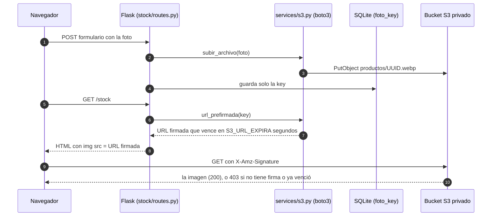
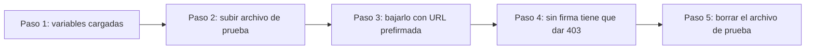

# Guía — Crear y conectar el bucket de AWS S3 (Jumbox)

> **Estado (04/11/2026):** bucket privado **`jumboxs3`** creado en `sa-east-1`, con usuario IAM `jumbox-app` de política mínima, y verificado con `flask --app run s3-check` (5/5 OK). Falta solo cargar las mismas variables `AWS_*` y `S3_BUCKET` en **Render → Environment**.  
> **Basado en:** Clase 14 (slides 20 a 24). Los nombres de variables son los mismos: `AWS_ACCESS_KEY_ID`, `AWS_SECRET_ACCESS_KEY`, `AWS_DEFAULT_REGION` y `S3_BUCKET`.  
> **Consola y precios de AWS consultados el 04/11/2026:** las pantallas y los precios **pueden cambiar**.

---

## 1. Qué hace Jumbox con S3

| Qué se sube | Desde dónde | Key en el bucket |
|---|---|---|
| Fotos de productos | Stock → nuevo o editar producto | `productos/UUID.ext` |
| Fotos migradas del sistema Java | `app/seed.py`, al sembrar la base | `productos/seed/1.webp` … `4.webp` |
| Comprobantes de pago a proveedores | Proveedores → registrar pago | `comprobantes/UUID.ext` |
| Archivo de prueba (se borra solo) | `flask --app run s3-check` | `diagnostico/prueba-UUID.txt` |

Como dice la slide 20: en Render el disco es **efímero** y los archivos se pierden en cada deploy. Por eso **la base guarda solo la key** y el archivo vive en el bucket. Si `S3_BUCKET` queda vacío, la app usa el **modo local** (`app/static/uploads/`) y no se rompe.



---

## 2. Paso 0: ¿qué tipo de cuenta AWS tienen?

Desde el 16/09/2026 AWS tiene dos formas de crear una cuenta, y **cambia la región que se puede usar**:

| Tipo de cuenta | Cómo se reconoce | Región para el bucket |
|---|---|---|
| **Clásica / "advanced"** | Hay usuario root y un **selector de región** arriba a la derecha | `sa-east-1` (São Paulo), como en la clase |
| **Experiencia nueva** ("Sign up for AWS (new)") | Se entra con Google o GitHub, aparecen **Projects** y **AWS Settings**, y **no hay selector de región** | **`us-east-2` (Ohio)**: AWS la fija para Argentina y el resto de LATAM |

En la experiencia nueva, crear el bucket en `sa-east-1` falla con *"explicit deny in a service control policy"*. Lo más simple es usar `us-east-2` y poner `AWS_DEFAULT_REGION=us-east-2`: **el código no cambia**. La otra opción es crear una cuenta clásica en <https://signin.aws.amazon.com/signup?request_type=register>.

> Conviene trabajar con un usuario administrador y no con el root.

---

## 3. Paso 1: crear el bucket privado

1. Entrá a <https://console.aws.amazon.com/s3/>.
2. **Región:** en la barra superior elegí **South America (São Paulo) sa-east-1** (en la experiencia nueva se saltea este paso: queda `us-east-2`). **No se puede cambiar después.**
3. Panel izquierdo: **General purpose buckets** → **Create bucket**. Tipo: **General purpose** (no *Directory*).
4. **Bucket namespace:**
   - **Global:** el nombre clásico, único en todo AWS.
   - **Account regional namespace:** la consola agrega sola el sufijo `-IDdeCuenta-sa-east-1-an`. Si lo elegís, en `S3_BUCKET` y en la política IAM va el **nombre completo con el sufijo**.
5. **Bucket name:** de 3 a 63 caracteres, solo minúsculas, números y guiones. Por ejemplo `jumbox-perez-2026`. **Sin puntos**: con un punto falla el certificado HTTPS. Tampoco pongas datos sensibles, porque el nombre aparece en las URLs.
6. **Copy settings from existing bucket:** dejalo vacío.
7. **Object Ownership:** **ACLs disabled (recommended)** → *Bucket owner enforced* (viene así por defecto).
8. **Block Public Access settings for this bucket:** dejá tildado **Block all public access**, con las 4 opciones. **No agregues bucket policy.**
9. **Bucket Versioning:** **Disable** (por defecto). Es más barato y después se borra más fácil.
10. **Tags** (opcional): `proyecto=jumbox`, `materia=AMS`. Sirve para seguir el costo.
11. **Default encryption:** **SSE-S3** (*Server-side encryption with Amazon S3 managed keys*). **No elijas SSE-KMS**: el usuario IAM necesitaría permisos de KMS y fallaría con `AccessDenied`.
12. **Advanced settings → Object Lock:** **Disable**.
13. **Create bucket.** Copiá el **nombre exacto** y la **región** (columna *AWS Region*): son `S3_BUCKET` y `AWS_DEFAULT_REGION`.

No hace falta configurar CORS: la app muestra las imágenes con `` y los comprobantes con `<a href>`, y eso no lo necesita.

---

## 4. Paso 2: usuario IAM con permisos mínimos

La app entra con las claves de un usuario IAM que **solo** tiene permisos sobre **ese** bucket (slide 21).

1. Abrí <https://console.aws.amazon.com/iam/> → **Users** → **Create user**.
2. **User name:** `jumbox-s3-app`. **No** tildes *Provide user access to the AWS Management Console*: es un usuario para la app, sin contraseña. → **Next**.
3. **Set permissions:** elegí **Attach policies directly** y **no marques ninguna** (nada de `AmazonS3FullAccess`). No uses *Add user to group*. → **Next**.
4. (Opcional) Tag `proyecto=jumbox` → **Create user** → **View user**.
5. En el usuario: pestaña **Permissions** → **Add permissions** → **Create inline policy**.
6. **Policy editor:** elegí **JSON**, borrá el ejemplo y pegá la política de abajo, **reemplazando `NOMBRE-DEL-BUCKET`** por el nombre real. → **Next**.
7. **Policy name:** `JumboxS3MinimoPrivilegio` → **Create policy**.
8. Verificá que en *Permissions policies* aparezca **solo** esa política, de tipo *Customer inline*.

**Política lista para copiar:**

```json
{
  "Version": "2012-10-17",
  "Statement": [
    {
      "Sid": "JumboxObjetosDelBucket",
      "Effect": "Allow",
      "Action": [
        "s3:PutObject",
        "s3:GetObject",
        "s3:DeleteObject"
      ],
      "Resource": "arn:aws:s3:::NOMBRE-DEL-BUCKET/*"
    },
    {
      "Sid": "OpcionalListBucketPara404",
      "Effect": "Allow",
      "Action": "s3:ListBucket",
      "Resource": "arn:aws:s3:::NOMBRE-DEL-BUCKET"
    }
  ]
}
```

Cómo explicarla:

| Sentencia | Qué permite | ¿Hace falta? |
|---|---|---|
| `JumboxObjetosDelBucket` | Subir (`PutObject`), leer (`GetObject`) y borrar (`DeleteObject`) **objetos** del bucket. Es exactamente lo de la slide 23. | **Sí.** Alcanza para todo lo que hace el código. |
| `OpcionalListBucketPara404` | Listar el bucket. Va sobre el ARN **del bucket**, sin `/*`. | **No.** Sirve para depurar: con ella, una key inexistente da `404 NoSuchKey` en vez de `403 AccessDenied`. Se puede borrar. |

- `NOMBRE-DEL-BUCKET/*` = "todos los objetos de ese bucket". Las acciones de objeto **necesitan el `/*`**.
- **Endurecimiento opcional:** se puede limitar `Resource` a `productos/*` y `comprobantes/*`. **Si lo hacen, agreguen también `arn:aws:s3:::NOMBRE-DEL-BUCKET/diagnostico/*`**, porque si no `s3-check` falla al subir el archivo de prueba.

---

## 5. Paso 3: access keys

1. IAM → Users → `jumbox-s3-app` → pestaña **Security credentials** → **Access keys** → **Create access key**.
2. Caso de uso: **Application running outside AWS** (la app corre en Render) u **Other**. Las dos sirven: solo cambian las recomendaciones que muestra AWS. Si aparece la casilla de confirmación, tildala → **Next**.
3. (Opcional) Description tag: `jumbox-render-2026` → **Create access key**.
4. **Show** o **Download .csv file**. **Es la única vez que se ve el Secret access key.** Guardá el `.csv` **fuera del proyecto**: nunca en el repo, en un chat ni en una captura.
5. **Access key ID** (empieza con `AKIA`) → `AWS_ACCESS_KEY_ID`. **Secret access key** → `AWS_SECRET_ACCESS_KEY`.
6. Recomendado: una clave para local y otra para Render (AWS permite 2 por usuario), así se puede desactivar una sin cortar la otra.

---

## 6. Paso 4: cargar las variables en local (`.env`)

Como en la slide 14: `load_dotenv()` carga el `.env` y `config.py` lo lee con `os.environ.get(...)`. Si no existe, copiá `.env.example` a `.env` y completá **sin espacios de más**:

```dotenv
AWS_ACCESS_KEY_ID="AKIA................"
AWS_SECRET_ACCESS_KEY="el-secreto-del-csv"
AWS_DEFAULT_REGION="sa-east-1"
S3_BUCKET="jumbox-perez-2026"
S3_URL_EXPIRA="3600"
```

| Variable | De dónde sale | Ojo con |
|---|---|---|
| `AWS_ACCESS_KEY_ID` | Paso 3 | No intercambiarla con el secret |
| `AWS_SECRET_ACCESS_KEY` | Paso 3 (el `.csv`) | Que no quede cortada ni con espacios |
| `AWS_DEFAULT_REGION` | Columna *AWS Region* del bucket | **Siempre cargarla.** Si falta, `config.py` usa `us-east-1` y falla con `PermanentRedirect`. En la experiencia nueva: `us-east-2`. |
| `S3_BUCKET` | Nombre exacto del bucket | Con el sufijo `-an` si usaron *account regional namespace* |
| `S3_URL_EXPIRA` | Segundos que dura cada URL prefirmada | Máximo `604800` (7 días). `3600` alcanza. |

**Ojo en Windows:** `load_dotenv()` **no pisa** las variables que ya existen en el sistema. Si alguna vez usaron `setx` o el AWS CLI, revisen con:

```powershell
Get-ChildItem Env:AWS*
```

Si aparecen claves viejas, ganan sobre el `.env`.

**Importante: la base local ya está sembrada en modo local.** Los productos 1 a 4 apuntan a `productos/seed/1.webp`, `2.webp`, `3.jpg` y `4.webp`, que hoy están solo en `app/static/uploads/`. Al activar S3 esas keys no existen en el bucket y las 4 imágenes dan 403. Hay dos arreglos:

- `flask --app run seed --reset`: **borra los datos locales** y vuelve a sembrar, esta vez subiendo las fotos a S3.
- O subir a mano esos 4 archivos desde la consola, en una carpeta `productos/seed/`, con los mismos nombres.

Después: `python run.py`. El header muestra **"AWS S3 Activo"**, pero ese badge solo mira que `S3_BUCKET` tenga valor. **La prueba real es `s3-check`** (Paso 6).

---

## 7. Paso 5: cargar las variables en Render

1. Dashboard → tu Web Service → **Environment** → **+ Add Environment Variable** (o **Add from .env** para pegar varias juntas).
2. Cargá `AWS_ACCESS_KEY_ID`, `AWS_SECRET_ACCESS_KEY`, `AWS_DEFAULT_REGION` y `S3_BUCKET` (y, si querés, `S3_URL_EXPIRA`). Los valores van **sin comillas** y sin espacios ni saltos de línea al final.
3. **Save, rebuild, and deploy** (o **Save and deploy**). *Save only* no aplica nada hasta el próximo deploy.
4. En Render el SQLite se recrea en cada deploy y el seed **sube solo** las fotos `productos/seed/...` si no están en el bucket (no las duplica).
5. Si después cambian una clave o la región, hay que **redeployar**: el cliente de boto3 se crea una sola vez por proceso (singleton).

El `.env` **nunca** se sube a Render ni a git.

---

## 8. Paso 6: verificar con `flask --app run s3-check`

En local, con el `.venv` activo y desde `supermercado/`:

```powershell
flask --app run s3-check
```

El comando (`app/cli.py`) prueba S3 de punta a punta, muestra `[OK]` o `[ERROR]` en cada paso con una pista en español y **termina con exit code 1 si algo falla**. Sin `S3_BUCKET` avisa que la app está en **modo local** y también sale con 1. Salida real con el bucket del equipo:

```text
[OK]    1. Variables cargadas -> bucket=jumboxs3 · región=sa-east-1 · access key=...XXXX · secret=cargado
[OK]    2. Subir archivo de prueba (PutObject) -> diagnostico/prueba-7d00cca2d7c14c3cb0412dfc7e291fd3.txt
[OK]    3. Bajarlo con URL prefirmada (GetObject) -> HTTP 200, contenido correcto
[OK]    4. Bucket privado (GET sin firma) -> HTTP 403: nadie lo puede leer sin URL firmada
[OK]    5. Borrar archivo de prueba (DeleteObject) -> borrado
RESULTADO: TODO OK, el bucket funciona.
```



| Paso | Qué verifica | Si falla, revisá |
|---|---|---|
| 1. Variables | Que estén `S3_BUCKET`, `AWS_ACCESS_KEY_ID`, `AWS_SECRET_ACCESS_KEY` y la región (**sin mostrar los secretos**) | `.env` / Render; `Get-ChildItem Env:AWS*` |
| 2. Subida | `s3.subir_archivo` → `PutObject` de `diagnostico/prueba-UUID.txt` | Credenciales, nombre del bucket, `s3:PutObject` en la política |
| 3. URL prefirmada | `s3.url_prefirmada` + descarga con `requests.get`: tiene que dar **200** con el mismo contenido | `s3:GetObject`, región igual a la del bucket, secret bien copiado |
| 4. Bucket privado | Un GET **sin firma** a `https://BUCKET.s3.REGION.amazonaws.com/KEY` tiene que dar **403** | Si da 200, el bucket es público: volvé a activar **Block all public access** y sacá cualquier bucket policy |
| 5. Borrado | `s3.borrar` → `DeleteObject` | `s3:DeleteObject` en la política |

**En Render:** el plan Free no suele tener Shell, así que corran `s3-check` en local con las mismas variables. En la app desplegada, alcanza con ver que las fotos de Stock carguen.

**Demostración para la entrega de que el bucket es privado:**

1. En Stock, clic derecho sobre una foto → *Abrir imagen en una pestaña nueva*. La URL tiene `X-Amz-Signature=...` y la imagen se ve.
2. Borrá todo lo que viene desde el `?` y recargá: S3 responde **403 AccessDenied**.
3. Si la página queda abierta más de `S3_URL_EXPIRA` segundos, la URL vence (*Request has expired*). Al recargar la página se genera una nueva.

---

## 9. Errores comunes

| Error | Causa probable | Solución |
|---|---|---|
| `AccessDenied` (403) en Put/Get/Delete: *"…is not authorized to perform: s3:PutObject…"* | Falta la acción en la política; `Resource` mal escrito (sin `/*`, con un error de tipeo o sin el sufijo `-an`); la política está en otro usuario; el bucket usa SSE-KMS | Revisar el JSON, confirmar que la política esté en el usuario dueño de esa access key y usar SSE-S3 |
| `AccessDenied` con *"explicit deny in a service control policy"* | Cuenta de la experiencia nueva usando una región que no es la asignada | Crear el bucket en `us-east-2` (ver Paso 0) |
| `NoSuchBucket` (404) | `S3_BUCKET` con un error de tipeo, mayúsculas, comillas o espacios; bucket borrado o de otra cuenta | Copiar el nombre exacto desde *General purpose buckets* |
| `InvalidAccessKeyId` (403) | Access key mal copiada, desactivada o de otra cuenta; ID y secret intercambiados; una `AWS_ACCESS_KEY_ID` vieja de Windows pisa el `.env` | Revisar IAM → Security credentials, volver a copiar del `.csv`, correr `Get-ChildItem Env:AWS*` |
| `SignatureDoesNotMatch` (403) | Secret cortado, con espacios o con comillas en Render; URL prefirmada modificada a mano | Pegar el secret de nuevo y no editar la URL |
| `PermanentRedirect` (301) | `AWS_DEFAULT_REGION` distinta de la región del bucket (típico: falta en Render y queda `us-east-1`) | Poner la región del bucket y redeployar |
| `AuthorizationHeaderMalformed` / `AuthorizationQueryParametersError` (400) *"the region 'us-east-1' is wrong"* | La firma se calculó para otra región | La misma región en todos lados |
| `AuthorizationQueryParametersError` (400) *"X-Amz-Expires must be less than a week"* | `S3_URL_EXPIRA` mayor que `604800` | Usar `3600` |
| `NoCredentialsError: Unable to locate credentials` | `S3_BUCKET` cargado pero faltan las dos claves: las páginas con imágenes dan **500** | Cargar las 3 variables juntas, o dejar `S3_BUCKET` vacío |
| `AccessDenied` *"Request has expired"* | La página quedó abierta más que `S3_URL_EXPIRA`, o se desactivó la key que firmó la URL | Recargar la página |
| `RequestTimeTooSkewed` (403) | El reloj de la PC está desfasado más de 15 minutos | Windows → Configuración → Hora → **Sincronizar ahora** |
| `EndpointConnectionError` / `SSLError` | Región mal escrita (por ejemplo `sa-east1`) o bucket con puntos en el nombre | Usar el código exacto de región y un nombre sin puntos |
| `BucketAlreadyExists` (409) al crear el bucket | Otra cuenta ya usa ese nombre | Elegir otro nombre o usar *account regional namespace* |
| `head_object` da 403 para una key que no existe | **No es un error:** sin `s3:ListBucket`, S3 responde 403 en vez de 404 | Nada, o agregar la sentencia opcional |

---

## 10. Lo que conviene saber del código actual (al 04/11/2026)

Para la defensa, y para no asustarse si pasa algo:

1. **Cargar las 3 variables juntas.** Si está `S3_BUCKET` pero faltan las claves, Dashboard, Stock, POS y Proveedores dan 500 al armar las URLs de las imágenes.
2. **Las subidas no atrapan errores de S3.** Si falla una subida en Stock o en Proveedores, se ve un 500, y el producto puede quedar creado sin foto. Por eso **conviene pasar `s3-check` antes** de usar la app.
3. **El seed no avisa si no pudo subir una foto:** el producto queda sin imagen sin dar error. Si faltan fotos, revisen la región y la política.
4. **Con credenciales incorrectas, las URLs se generan igual** (la firma se calcula en la PC, sin consultar a AWS): las imágenes salen rotas sin aviso. De nuevo: `s3-check`.
5. **Cada carga de página genera URLs nuevas**, así que el navegador no las cachea. Hay más pedidos GET, pero el costo sigue siendo de centavos.

---

## 11. Costos y free tier (consultado el 04/11/2026, **puede cambiar**)

- **Cuentas creadas desde el 15/07/2025:** reciben **USD 100 de crédito** (más hasta USD 100 por completar actividades). Al crear la cuenta se elige:
  - **Free plan:** no cobra nada y dura 6 meses o hasta agotar los créditos. Después la cuenta se cierra y hay 90 días para pasar a pago antes de que AWS borre los datos.
  - **Paid plan:** cobra solo lo que exceda los créditos.
- Sobre cuándo vencen los créditos, las páginas de AWS se contradicen (6 o 12 meses): **mírenlo en Billing and Cost Management → Credits**.
- Las ofertas viejas de 12 meses (5 GB, 20.000 GET y 2.000 PUT) ya vencieron para todas las cuentas.
- Los primeros **100 GB/mes de transferencia a internet son gratis**.

Precio de S3 Standard en `sa-east-1` (lista de AWS del 04/11/2026):

| Concepto | Precio | Ejemplo Jumbox | Costo aprox. |
|---|---|---|---|
| Almacenamiento | USD 0,0405 por GB al mes | 300 archivos de ~300 KB (90 MB) | USD 0,004/mes |
| PUT (subidas) | USD 0,007 cada 1.000 | 2.000 subidas | USD 0,014 |
| GET (ver imágenes) | USD 0,0056 cada 10.000 | 100.000 vistas | USD 0,056 |
| Transferencia a internet | USD 0,15/GB, después de los 100 GB gratis | ~30 GB | USD 0 |
| **Total** | | | **menos de USD 0,10/mes** (lo cubren los créditos) |

En `us-east-2` es más barato todavía: USD 0,023/GB, USD 0,005 cada 1.000 PUT y USD 0,004 cada 10.000 GET. Los 403 de pedidos anónimos de terceros no se le cobran al dueño del bucket.

**Recomendado:** crear un **AWS Budget de USD 1** con alerta por mail (Billing → Budgets).

---

## 12. Limpieza al terminar la cursada

1. **Primero la app:** vaciá o sacá `S3_BUCKET` (y las `AWS_*`) en Render → Environment → **Save and deploy**, y también en el `.env` local. Así la app vuelve al modo local y no da 500 cuando el bucket ya no exista.
2. (Opcional) Descargá lo que quieras guardar: seleccionar los objetos → **Download**.
3. **Vaciar el bucket:** S3 → *General purpose buckets* → seleccionarlo → **Empty** → escribir `permanently delete` → **Empty**.
4. **Borrar el bucket:** seleccionarlo → **Delete** → escribir el nombre → **Delete bucket**. Si el nombre era del namespace global, otra cuenta puede tomarlo: por eso primero se saca de Render (paso 1).
5. **Access keys:** IAM → Users → `jumbox-s3-app` → *Security credentials* → *Access keys* → **Actions → Deactivate** y después **Actions → Delete** (pide escribir el Access key ID). Esto también invalida al instante las URLs prefirmadas que firmó.
6. **Usuario:** IAM → Users → tildar `jumbox-s3-app` → **Delete** → escribir el nombre. Se borra junto con su política inline.
7. Borrá el `.csv` y cualquier copia de las claves. Revisá que no quede ninguna `AWS_*` en Render, en el `.env`, en Windows (`Get-ChildItem Env:AWS*`) ni en `~/.aws/credentials`.
8. Revisá **Billing and Cost Management → Bills / Credits** para confirmar que no quedan cargos. (Opcional) Cerrar la cuenta: en la clásica, *Account → Close account*; en la experiencia nueva, desde *AWS Settings*.

Con el AWS CLI (si lo tienen configurado con un usuario administrador):

```powershell
aws s3 rb s3://NOMBRE-DEL-BUCKET --force
aws iam delete-access-key --user-name jumbox-s3-app --access-key-id AKIA................
aws iam delete-user-policy --user-name jumbox-s3-app --policy-name JumboxS3MinimoPrivilegio
aws iam delete-user --user-name jumbox-s3-app
```

---

## 13. Para la defensa: cómo explicarlo en 4 frases

1. "El bucket es **privado** (Block Public Access activado): nadie puede abrir un archivo sin una URL firmada."
2. "La app entra con un **usuario IAM de mínimo privilegio**: solo puede subir, leer y borrar objetos de **ese** bucket."
3. "En la base guardamos **solo la key**; para mostrar una imagen, `services/s3.py` genera una **URL prefirmada** que vence en una hora."
4. "Lo verificamos con `flask --app run s3-check`: sube, descarga con firma, comprueba que sin firma da 403 y borra."

---

## Fuentes (consultadas el 04/11/2026)

- Material de la cátedra: Clase 14, slides 20 a 24 (S3 desde Flask con boto3).
- Buckets y namespaces: <https://docs.aws.amazon.com/AmazonS3/latest/userguide/create-bucket-overview.html> · <https://docs.aws.amazon.com/AmazonS3/latest/userguide/gpbucketnamespaces.html>
- URLs prefirmadas y errores 403: <https://docs.aws.amazon.com/AmazonS3/latest/userguide/using-presigned-url.html> · <https://docs.aws.amazon.com/AmazonS3/latest/userguide/troubleshoot-403-errors.html>
- IAM: <https://docs.aws.amazon.com/IAM/latest/UserGuide/id_users_create.html> · <https://docs.aws.amazon.com/IAM/latest/UserGuide/access-keys-admin-managed.html> · <https://docs.aws.amazon.com/IAM/latest/UserGuide/id_users_remove.html>
- Cuentas nuevas y regiones: <https://docs.aws.amazon.com/accounts/latest/reference/sign-in-new.html> · <https://docs.aws.amazon.com/accounts/latest/reference/project-regions.html>
- Free tier y precios: <https://aws.amazon.com/free/free-tier-faqs/> · <https://aws.amazon.com/s3/pricing/>
- Borrado: <https://docs.aws.amazon.com/AmazonS3/latest/userguide/delete-bucket.html>
- Render: <https://render.com/docs/configure-environment-variables>
